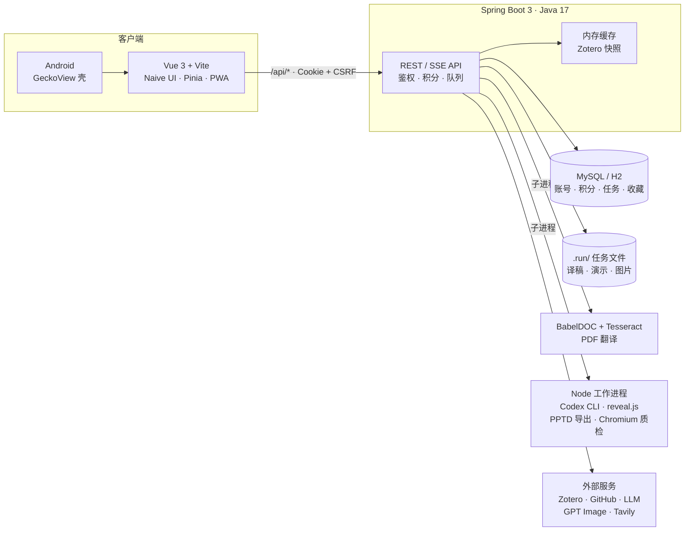

<div align="center">

# 闪闪小站 · Shimmer Desk

**一个面向个人研究与创作的全栈工作台：文献、翻译、演示文稿、AI 生图，再加一点月光下的塔罗。**

简体中文 · [English](README.en.md)

[](LICENSE)
[](LICENSE-ASSETS.md)


[](CONTRIBUTING.md)


</div>

## 目录

- [简介](#简介)
- [功能一览](#功能一览)
- [界面预览](#界面预览)
- [架构](#架构)
- [技术栈](#技术栈)
- [快速开始](#快速开始)
- [配置](#配置)
- [仓库结构](#仓库结构)
- [测试与检查](#测试与检查)
- [部署](#部署)
- [路线图](#路线图)
- [参与贡献](#参与贡献)
- [许可与致谢](#许可与致谢)

## 简介

闪闪小站把日常研究会用到的工具放进同一个站点：从 Zotero 读文献，用 BabelDOC 保留版式翻译 PDF，把资料交给 Codex 生成可编辑的 PPTX 或 reveal.js 网页演示，用 GPT Image 2 生图；工作之余，还可以在夜空主题的「月下」里抽卡、收藏和占卜。

它是一个可以自己部署的完整应用，而不只是前端演示：

- **前后端分离**：Vue 3 前端只访问本站 `/api/*`；外部 API、密钥、文件代理、队列与子进程全部由 Spring Boot 后端负责。
- **账号与积分**：邀请码注册、HttpOnly Cookie + CSRF 会话、每日签到、按任务预扣积分，失败时有可重试的退款补偿。
- **低配可用**：按 **2 核 / 4 GB** 服务器设计，长任务走有界队列、单 worker 与磁盘任务文件，并带内存与 Swap 保护。
- **多端访问**：支持 PWA 与深色模式，另有基于 GeckoView 的 Android 客户端。

## 功能一览

| 模块 | 路由 | 说明 | 状态 |
| --- | --- | --- | --- |
| 📚 文献库 | `/publications` | 同步 Zotero 私有文献库，按分组、关键词、类型浏览；PDF / Markdown / 网页快照附件由后端按需代理，支持引用导出 | ✅ 已上线 |
| 🌐 论文翻译 | `/translate` | PDF 由 BabelDOC 输出纯中文 / 双语版，尽量保留版式、图片和公式；无文字层的扫描页先做 Tesseract OCR；参考文献后的附录也会翻译；PNG/JPG 等图片走视觉模型 | ✅ 已上线 |
| 📊 PPT 生成 | `/contact` | 输入提示词或上传资料（PDF/Word/PPT/Excel/Markdown/网页等）。PPTX：Codex 在约 30 套 PPTD 设计系统中排版，再导出为可编辑文件。HTML：13 套 reveal.js 主题，13 类语义布局，四档动效。可智能推荐或指定 3–30 页，可选联网研究与 GPT Image 2 配图，带真实渲染质检和版本化修改 | ✅ 已上线 |
| 🎨 GPT 生图 | `/image-generate` | 文生图与参考图编辑，可选画幅和质量，保留历史记录，下载需鉴权；失败按任务状态退还积分 | ✅ 已上线 |
| 🌙 月下收藏库 | `/moonlit-collection` | 22 张大阿卡纳，每张 5 个独立主题，共 110 款主题卡；带倾斜、厚度与箔光交互的全息卡面 | ✅ 已上线 |
| ✨ 月下抽卡 | `/moonlit-draw` | 用积分抽取主题卡，扣费和抽取在同一事务内完成，单抽价格可在后台配置；每日签到附赠今日牌，重复卡累计张数 | ✅ 已上线 |
| 🔮 月下占卜 | `/tarot-reading` | 提问 → 选牌阵（单张 / 圣三角 / 二择一）→ 洗牌切牌 → 牌扇选牌 → 3D 翻牌 → 即时牌义 → 可选 AI 深度解读；牌由服务器决定，区分正逆位 | 🚧 前端已完成，后端开发中 |
| 🐙 GitHub 项目 | `/news` | 展示指定仓库，并按周、按月统计全 GitHub 新项目 Star 榜，附 AI 摘要；README 由后端代理获取 | ✅ 已上线 |
| 💬 留言板 | `/guestbook` | 公开留言，支持单层回复和点赞，并有站内通知；作者可删除自己的内容，root 可统一管理 | ✅ 已上线 |
| 🛠️ 管理后台 | `/admin` | 今日概览、各栏目可见范围、API 与模型配置、任务文件保留期、积分定价与签到、邀请码、用户与额度流水 | ✅ 已上线 |
| 📱 Android | `/download-app` | GeckoView 原生壳，支持文件上传下载、App Link，前台恢复时自动刷新 | ✅ 内测 `0.3.7-internal` |

## 界面预览

### 📚 Zotero 文献库

分组、标签、附件和引用导出集中在一页。附件按需流式下载，浏览器和 JVM 的内存占用都有上限。


### 🌐 PDF / 图片翻译

流程分四步：上传、配置、翻译、预览结果。可选页码范围、译文字体和速度模式；长文档按单页分片排队，内存紧张时自动降速。


### 📊 资料转 PPT

可以只给提示词、只给资料，也可以两者都给。模板区一直展开，每套都能看 5 页真实样稿；页数、联网研究、配图策略和 AI 生图都可以按任务调整。


### 🎨 GPT 生图


### 🌙 月下收藏库与抽卡

收藏墙按 22 张基础牌分组，点开任意一张，可以切换它的 5 个独立主题并查看寓意。


<table>
  <tr>
    <td width="55%"></td>
    <td width="45%"></td>
  </tr>
  <tr>
    <td align="center">主题详情：五个独立主题与收藏张数</td>
    <td align="center">积分抽卡：揭示动画与主题寓意</td>
  </tr>
</table>

### 🔮 月下占卜（开发中预览）

夜空背景用 Canvas 绘制，配有星盘、七芒星洗牌和 FLIP 飞入动画；动画只改动 transform 和 opacity，并适配「减少动态效果」设置。以下截图来自前端模拟模式（`VITE_TAROT_MOCK=1`）。

<table>
  <tr>
    <td width="68%"><br></td>
    <td width="32%"></td>
  </tr>
  <tr>
    <td align="center">桌面端：圣三角牌阵、洗牌与切牌</td>
    <td align="center">移动端：即时牌义与系列共鸣</td>
  </tr>
</table>

### 🐙 GitHub 项目雷达


## 架构



- 浏览器从不直接访问外部服务；文件下载和附件都经过带鉴权的后端代理。
- 每类长任务有自己的有界队列和单 worker。月下占卜任务以 SQL 为恢复依据，退款凭据单独记录。
- 后端重启后，未完成的任务会重新排队；失败时退款可以重试，界面不会提前显示退款成功。

## 技术栈

| 层 | 技术 |
| --- | --- |
| 前端 | Vue 3、Vite 5、Naive UI、Pinia、Vue Router、vue-i18n、PDF.js、marked + DOMPurify、Sass |
| 后端 | Spring Boot 3.2、Java 17、MyBatis-Plus、Spring JDBC、PDFBox、BCrypt |
| 数据 | MySQL（生产）/ H2（本地），磁盘任务文件 |
| 文档与演示 | BabelDOC、Tesseract、PyMuPDF、Docling / MarkItDown、Codex CLI、open-kimi-ppt-skill（PPTD）、reveal.js、Playwright + Chromium、LibreOffice、Poppler |
| 3D 卡面 | three.js（GLTF）、Blender（离线制作） |
| 移动端 | Android + Mozilla GeckoView |
| 运维 | `project.sh` 本地编排、systemd + Nginx、发布脚本带备份与回滚 |

## 快速开始

### 环境要求

| 必需 | 可选（对应功能才需要） |
| --- | --- |
| Java 17、Maven 3.9+ | [uv](https://github.com/astral-sh/uv) + BabelDOC 0.6.2、Tesseract（`eng`）：PDF 翻译 |
| Node.js 20+ 与 npm | LibreOffice、Poppler、Google Chrome / Chromium、Noto CJK 字体：PPT 渲染与质检 |
| macOS 或 Linux（bash） | MySQL 8：接近生产环境的本地数据库 |

### 启动

```bash
git clone https://github.com/Shimmersss/my_web.git
cd my_web
cp .env.local.example .env.local      # 至少填写 ROOT_PASSWORD
chmod 600 .env.local
npm --prefix backen install           # PPT 工作进程依赖，可选
PROJECT_DB_MODE=h2 ./project.sh start # 用内存 H2，不需要 MySQL
```

首次启动会自动安装前端依赖并打包后端。启动后：

- 前端：<http://localhost:3000>
- 后端：<http://localhost:8080>（`/api/health`）
- 用 `.env.local` 里的 `ROOT_USERNAME` / `ROOT_PASSWORD` 登录 root，然后在后台生成邀请码，用来注册普通账号。

常用命令：

```bash
./project.sh status            # 查看前后端与 MySQL 状态
./project.sh restart backend   # 只重启后端
./project.sh logs backend      # 跟踪后端日志
./project.sh stop              # 停止全部服务
```

> 💡 只想预览月下占卜界面？可以用 `VITE_TAROT_MOCK=1 npm --prefix front run dev` 启动前端，抽牌和 AI 解读会使用浏览器内的模拟数据，不请求后端；生产构建不包含模拟代码。

## 配置

所有密钥都从根目录的 `.env.local` 读取，这个文件已被 Git 忽略。[`.env.local.example`](.env.local.example) 列出了全部变量（只含空值或占位符），可以当作配置清单。

| 分组 | 主要变量 | 用途 |
| --- | --- | --- |
| 账号 | `ROOT_USERNAME`、`ROOT_PASSWORD`、`ADMIN_KEY`、`AUTH_COOKIE_SECURE` | root 初始化、会话 Cookie |
| 数据库 | `DB_URL`、`DB_DRIVER`、`DB_USERNAME`、`DB_PASSWORD` | 留空时使用 H2；生产指向 MySQL |
| 文献 | `ZOTERO_API_KEY`、`ZOTERO_USER_ID` | Zotero 同步 |
| 文本模型 | `LLM_API_URL`、`LLM_API_KEY`、`LLM_MODEL`、`LLM_VISION_*` | 图片翻译、摘要与解读，接口需兼容 OpenAI |
| PDF 翻译 | `BABELDOC_*`、`TRANSLATION_*` | BabelDOC 命令、模型、分片与资源保护 |
| 演示文稿 | `PPT_GENERATION_*`、`TAVILY_*`、`SEMANTIC_SCHOLAR_API_KEY` | Codex、渲染工具、联网研究、演示配图 |
| 生图 | `IMAGE_GENERATION_*`、`PPT_GENERATION_IMAGE_GENERATION_*` | GPT Image 2 接口与队列限制 |

大部分模型、定价、保留期和栏目可见范围也可以在 `/admin` 里在线调整。

## 仓库结构

```text
.
├── backen/                 Spring Boot 后端（包名 com.web.backen，目录名有意保留为 backen）
│   ├── src/main/java/      auth · zotero · translate · ppt · imagegen · moonlit · matchmaking · guestbook · github …
│   ├── src/main/resources/ application.yml、schema.sql、牌库与主题数据
│   └── scripts/            BabelDOC runner、OCR、文档解析、ppt-agent / ppt-codex 工作进程
├── front/                  Vue 3 前端
│   ├── src/views/          各页面（Publications、Translate、PptGenerate、TarotReading、Moonlit* …）
│   ├── src/components/     通用组件、塔罗与月下组件
│   └── public/             PWA、模板预览、塔罗素材与全息闪卡
├── android/                GeckoView Android 客户端
├── vendor/                 第三方运行时（open-kimi-ppt-skill）
├── deploy/                 发布、源站加固与 APK 发布脚本
├── docs/                   工作流、规格、塔罗美术规范与截图
├── output/                 塔罗美术制作工程与审查证据
└── project.sh              本地启动 / 停止 / 状态
```

## 测试与检查

按改动范围选择检查，完整对照表见[验证矩阵](docs/WORKFLOW.md#验证矩阵)：

```bash
npm --prefix front run build      # 前端构建，同时运行导航、PWA、PDF 预览、占卜流程等门禁
mvn -f backen/pom.xml test        # 后端测试
npm --prefix backen test          # PPT / HTML 工作进程测试
```

涉及真实 MySQL 事务时，请在独立测试库上运行 `MatchmakingMySqlIT`（见 WORKFLOW）。H2 测试通过不能代替 MySQL 验证。

## 部署

生产部署步骤、备份（SQL 和 `.run/` 都要备份）、资源参数和回滚方法见 [DEPLOYMENT.md](DEPLOYMENT.md)，Android 构建与发布见 [android/README.md](android/README.md)。

- 仓库不包含任何生产主机或凭据。发布目标只从本地权限为 `0600` 的 `.deploy.local` 或当前 shell 环境读取（模板见 [`.deploy.local.example`](.deploy.local.example)）。
- `/api/health` 返回 200 不代表发布成功，还要检查四类任务和待补偿状态，并跑一次真实任务。
- BabelDOC 处理文档时，工作集可能接近 2.8 GB。在 4 GB 机器上要固定单页分片，并保留 cgroup / Swap 保护。

## 路线图

- [x] Zotero 文献库、PDF / 图片翻译、扫描页 OCR
- [x] PPTX（PPTD）与 HTML（reveal.js）双链路演示生成
- [x] GPT 生图、留言板与站内通知、Android 客户端
- [x] 月下收藏库：110 款独立主题卡、积分抽卡、每日签到
- [ ] 月下占卜后端：牌阵抽牌、正逆位、AI 深度解读（[规格](docs/plans/2026-10-13-moonlit-divination.md)）
- [ ] 其余 21 张牌的完整分层 3D 主题资产（[美术规范](docs/tarot-v2/README.md)）
- [ ] PPTX 生成的按任务容器隔离与出网限制，之后再向普通用户开放

## 参与贡献

欢迎提交 Issue 和 PR！开始前请阅读：

- [贡献指南](CONTRIBUTING.md)：开发流程、检查命令和必须保持的约定
- [行为准则](CODE_OF_CONDUCT.md)
- [安全策略](SECURITY.md)：发现漏洞请私下报告，不要公开提交 Issue
- [文档索引](docs/README.md) 与 [项目工作流](docs/WORKFLOW.md)

## 许可与致谢

- **代码**：[MIT License](LICENSE) © 2026 Li Zexuan (Shimmersss)
- **美术素材与截图**：[CC BY-NC-SA 4.0](LICENSE-ASSETS.md)，包括塔罗牌面、110 款主题卡、全息闪卡素材、站点图标和 README 截图
- **第三方组件**：各自沿用原许可，完整清单见 [THIRD_PARTY_NOTICES.md](THIRD_PARTY_NOTICES.md)

特别感谢以下项目：[Vue](https://vuejs.org/)、[Naive UI](https://www.naiveui.com/)、[Spring Boot](https://spring.io/projects/spring-boot)、[BabelDOC](https://github.com/funstory-ai/BabelDOC)、[open-ppt-skill](https://github.com/jinwyp/open-ppt-skill)、[reveal.js](https://revealjs.com/)、[OpenAI Codex](https://github.com/openai/codex)、[PDF.js](https://mozilla.github.io/pdf.js/)、[three.js](https://threejs.org/)、[Tesseract](https://github.com/tesseract-ocr/tesseract)、[GeckoView](https://mozilla.github.io/geckoview/)、[Zotero](https://www.zotero.org/)、[Tarotoo 塔罗数据集](https://github.com/Tarotoo-com/tarotoo-tarot-dataset)和 [BJTU-Slides-Template](https://github.com/Allenpandas/BJTU-Slides-Template)。

> ⚠️ `vendor/open-kimi-ppt-skill/editor/` 中的编辑器资源按上游说明来自对 Kimi/neo-ppt 的逆向，不在 MIT 授权范围内。Fork 或再分发前，请先阅读 [THIRD_PARTY_NOTICES.md](THIRD_PARTY_NOTICES.md) 中的说明。
