<div align="center">

# Shimmer Desk · 闪闪小站

**A full-stack workbench for personal research and creative work: papers, translation, slide decks, AI images, and a little moonlit tarot.**

**English** · [简体中文](README.zh-CN.md)

[](LICENSE)
[](LICENSE-ASSETS.md)


[](CONTRIBUTING.md)

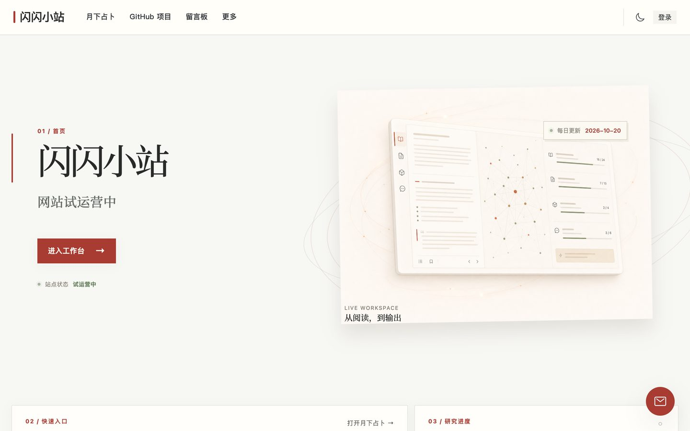

</div>

> The interface is in Chinese. Screenshots below come from a local instance with demo data.

## Contents

- [Overview](#overview)
- [Features](#features)
- [Screenshots](#screenshots)
- [Architecture](#architecture)
- [Tech stack](#tech-stack)
- [Quick start](#quick-start)
- [Configuration](#configuration)
- [Repository layout](#repository-layout)
- [Tests and checks](#tests-and-checks)
- [Deployment](#deployment)
- [Roadmap](#roadmap)
- [Contributing](#contributing)
- [License and credits](#license-and-credits)

## Overview

Shimmer Desk puts everyday research tools on one site: read your Zotero library, translate PDFs with BabelDOC while keeping their layout, turn source material into an editable PPTX or a reveal.js web deck with Codex, and generate images with GPT Image 2. Between tasks, you can draw, collect and read tarot cards in the night-sky "Moonlit" corner.

It is a complete, self-hostable application rather than a UI demo:

- **Clean separation** — the Vue 3 frontend only calls the site's own `/api/*`. External APIs, secrets, file proxies, queues and subprocesses all live in the Spring Boot backend.
- **Accounts and credits** — invite-code sign-up, HttpOnly cookie + CSRF sessions, daily check-in, credits reserved per task, and retryable refunds when a task fails.
- **Runs on small servers** — designed for **2 vCPU / 4 GB RAM**. Long jobs use bounded queues, single workers and disk-backed task files, with memory and swap guards.
- **Everywhere** — PWA support, dark mode, and an Android client built on GeckoView.

## Features

| Module | Route | What it does | Status |
| --- | --- | --- | --- |
| 📚 Library | `/publications` | Syncs a private Zotero library; browse by collection, keyword and type. The backend proxies PDF / Markdown / snapshot attachments on demand. Citation export included. | ✅ Live |
| 🌐 Translation | `/translate` | BabelDOC produces Chinese-only and bilingual PDFs that keep layout, figures and formulas. Scanned pages without a text layer go through Tesseract OCR first, and appendices after the references are translated too. PNG/JPG images go through a vision model. | ✅ Live |
| 📊 Slides | `/contact` | Start from a prompt and/or uploaded material (PDF, Word, PPT, Excel, Markdown, web pages…). **PPTX**: Codex lays out the deck in one of ~30 PPTD design systems, which is then exported as an editable file. **HTML**: 13 reveal.js themes, 13 semantic layouts and four motion levels. Pick 3–30 slides or let it decide, with optional web research and GPT Image 2 visuals. Real renders are quality-checked, and revisions are versioned. | ✅ Live |
| 🎨 Image studio | `/image-generate` | Text-to-image and reference-image editing with size and quality options. History is kept, downloads require auth, and failed tasks refund credits. | ✅ Live |
| 🌙 Moonlit collection | `/moonlit-collection` | 22 Major Arcana × 5 independent themes = 110 theme cards, shown as holographic cards with tilt, thickness and foil effects | ✅ Live |
| ✨ Moonlit draw | `/moonlit-draw` | Spend credits to draw theme cards; the charge and the draw share one transaction, and the price is set in the admin console. Daily check-in also grants a card of the day, and duplicates add to your count. | ✅ Live |
| 🔮 Moonlit reading | `/tarot-reading` | Ask → choose a spread (single / three-card / either-or) → shuffle and cut → pick from the fan → 3D flip → instant meanings → optional AI deep reading. The server draws the cards, upright or reversed. | 🚧 Frontend done, backend in progress |
| 🐙 GitHub radar | `/news` | Featured repositories plus weekly and monthly star rankings of new GitHub projects, with AI summaries. READMEs are fetched through the backend. | ✅ Live |
| 💬 Guestbook | `/guestbook` | Public messages with single-level replies, likes and in-site notifications. Authors can delete their own posts; root moderates everything. | ✅ Live |
| 🛠️ Admin | `/admin` | Daily overview, per-section visibility, API and model settings, task file retention, credit pricing and check-in, invite codes, users and the credit ledger | ✅ Live |
| 📱 Android | `/download-app` | GeckoView shell with file upload/download and App Links; it refreshes automatically when brought back to the foreground. | ✅ Beta `0.3.7-internal` |

## Screenshots

### 📚 Zotero library

Collections, tags, attachments and citation export on one page. Attachments are streamed on demand, so browser and JVM memory use stays bounded.

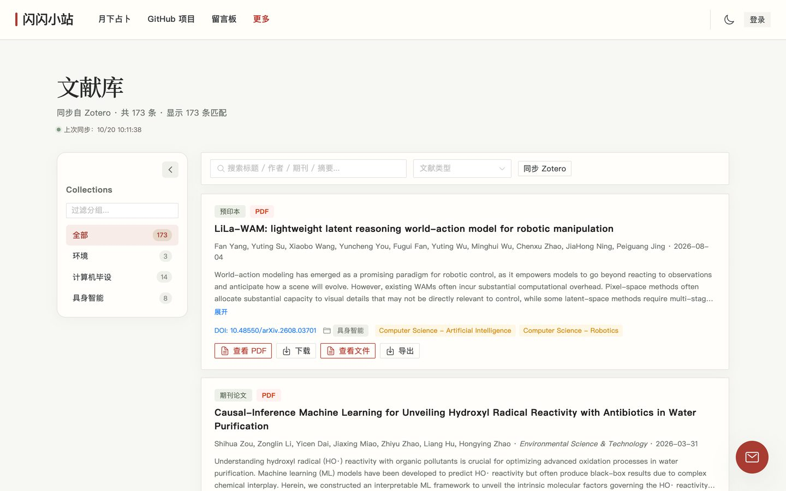

### 🌐 PDF and image translation

Four steps: upload, configure, translate, preview. Choose the page range, target font style and speed mode. Long documents are queued page by page and slow down automatically when memory is tight.

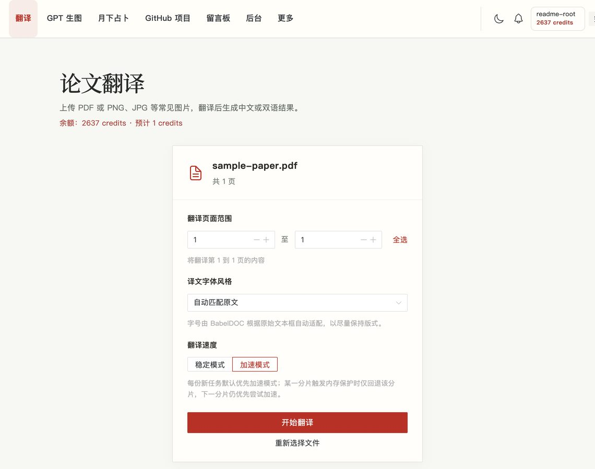

### 📊 Material to slides

Give it a prompt, some material, or both. Every template shows five real sample slides, and slide count, research, image strategy and AI images can be adjusted for each task.

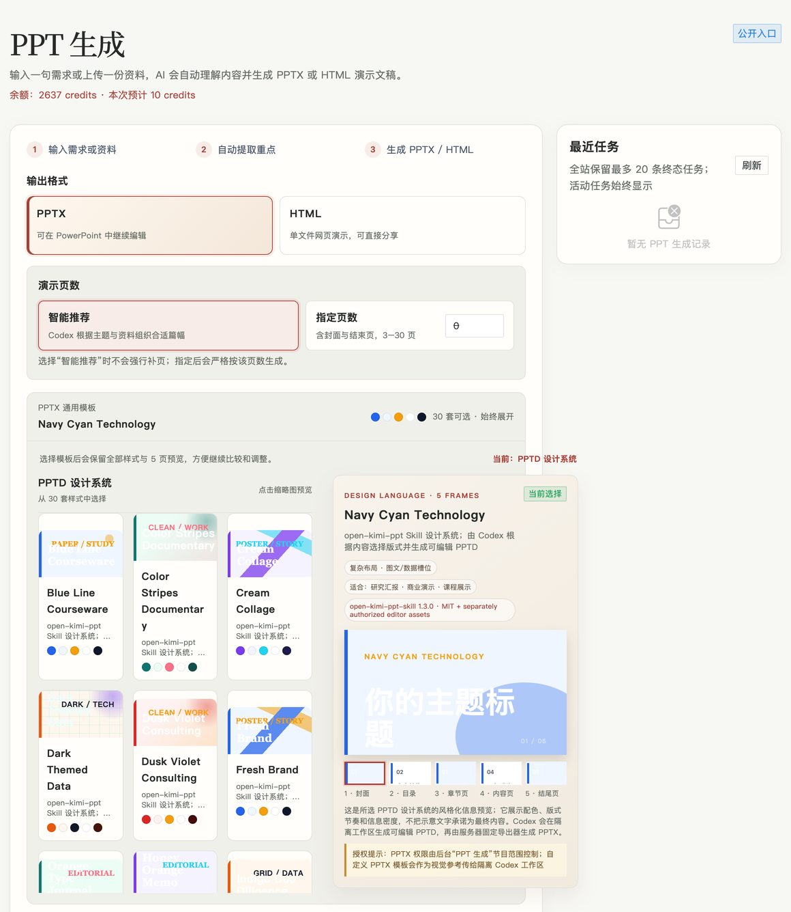

### 🎨 Image studio

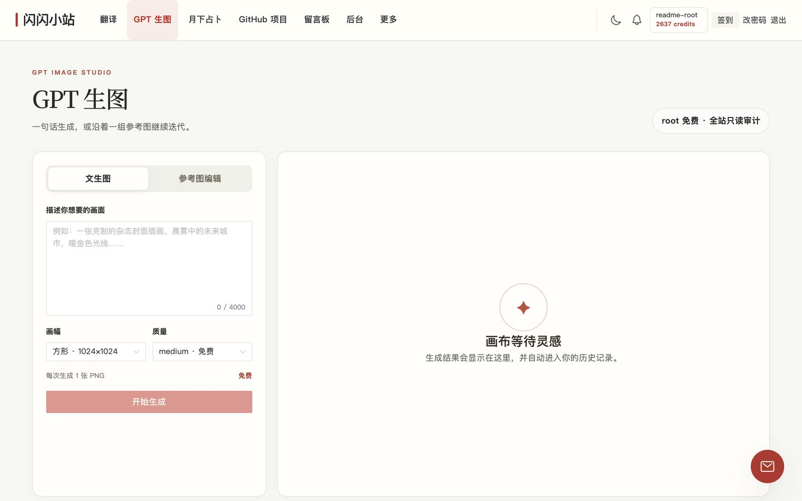

### 🌙 Moonlit collection and draws

The wall is grouped by the 22 base cards. Open one to switch between its five independent themes and read their meanings.

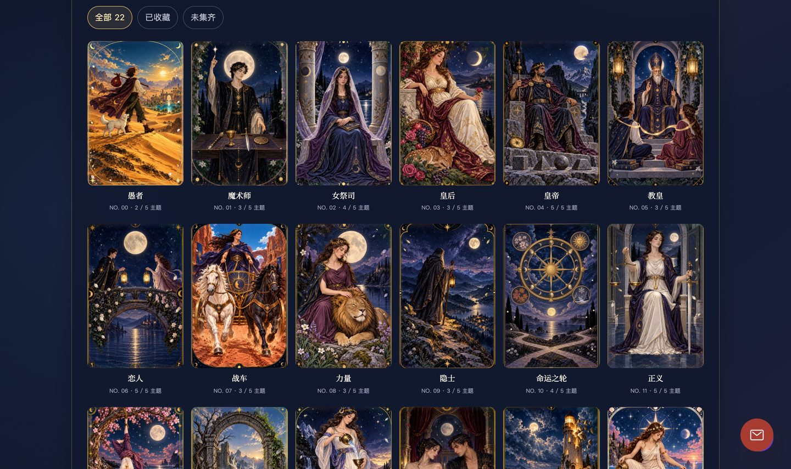

<table>
  <tr>
    <td width="55%">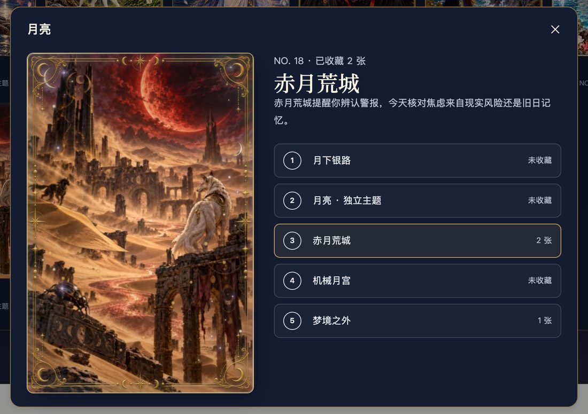</td>
    <td width="45%">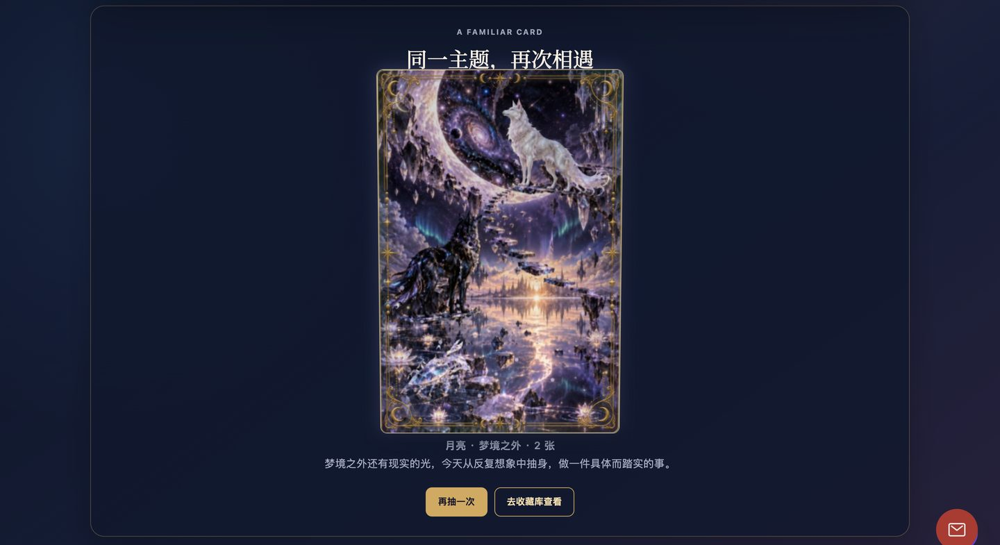</td>
  </tr>
  <tr>
    <td align="center">Theme detail: five independent themes and owned copies</td>
    <td align="center">Credit draw: reveal animation and theme meaning</td>
  </tr>
</table>

### 🔮 Moonlit reading (preview, in development)

The page has a Canvas night sky, an astrolabe, a heptagram shuffle and FLIP fly-ins. Animations only change transform and opacity, and they respect the reduced-motion setting. These screenshots use the frontend mock mode (`VITE_TAROT_MOCK=1`).

<table>
  <tr>
    <td width="68%">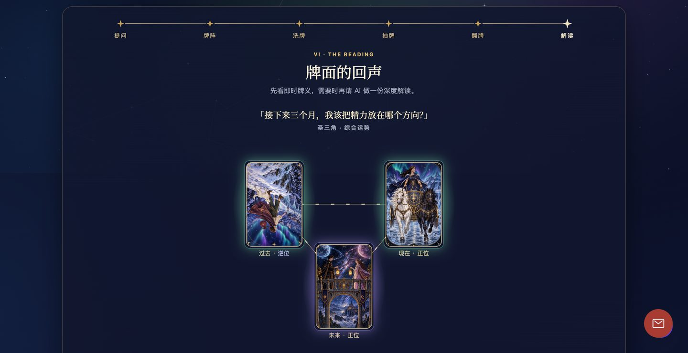<br>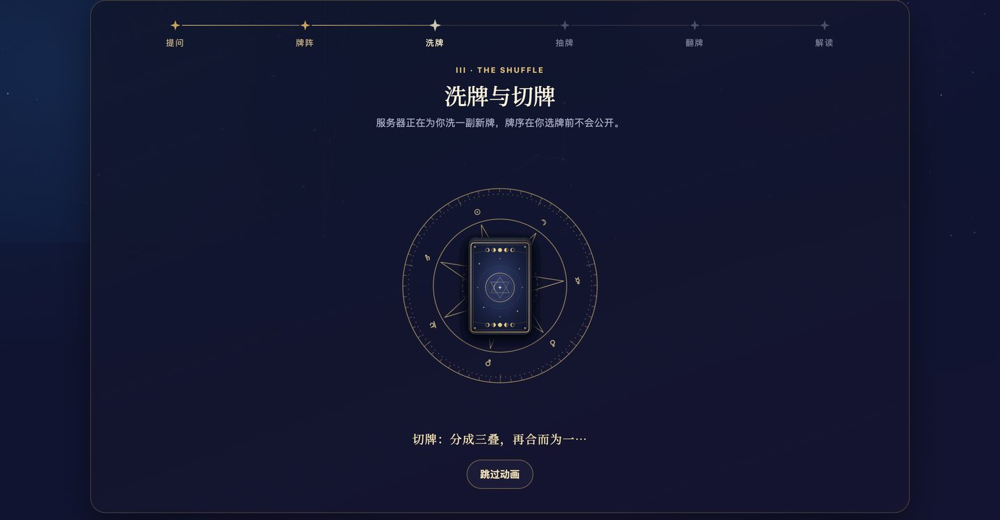</td>
    <td width="32%">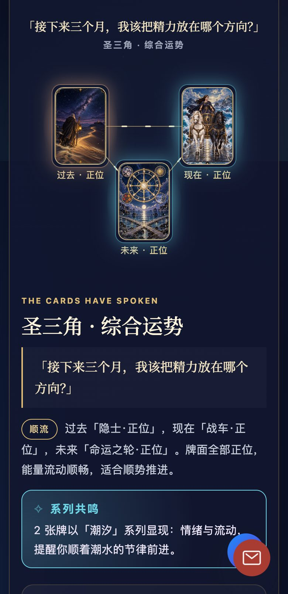</td>
  </tr>
  <tr>
    <td align="center">Desktop: three-card spread, shuffle and cut</td>
    <td align="center">Mobile: instant meanings and series resonance</td>
  </tr>
</table>

### 🐙 GitHub radar

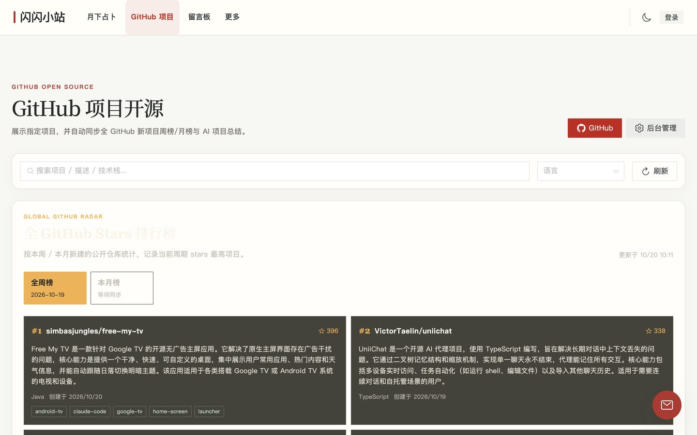

## Architecture

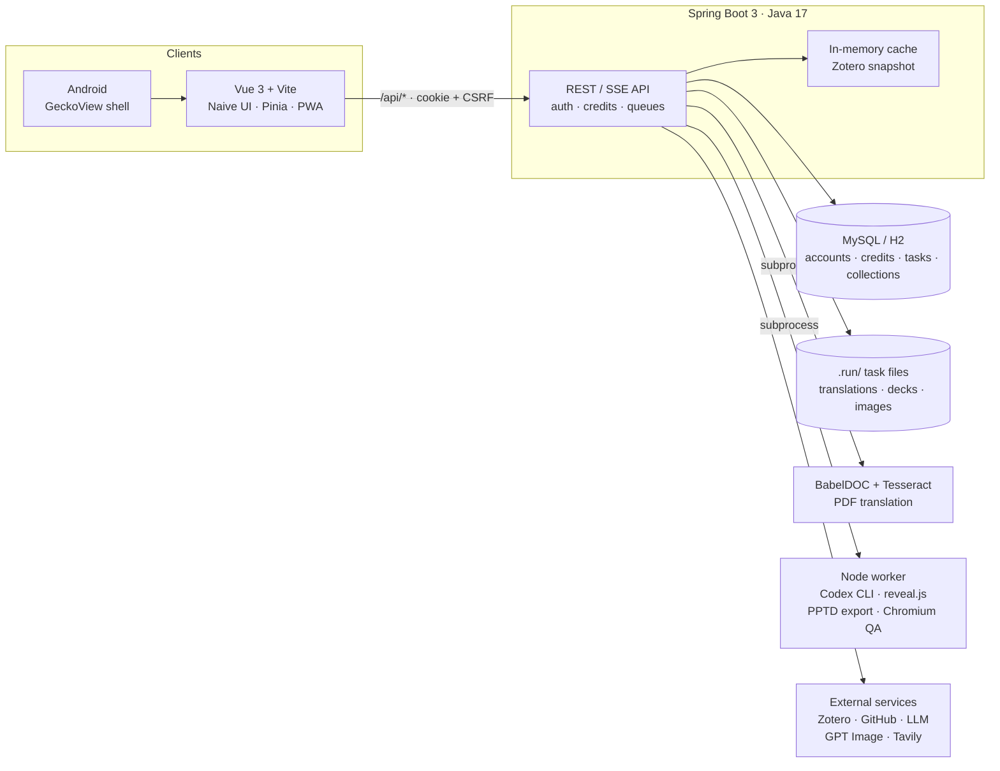

- The browser never calls external services directly; downloads and attachments go through authenticated backend proxies.
- Each kind of long job has its own bounded queue and a single worker. Moonlit reading tasks recover from SQL, and refund claims are recorded separately.
- Unfinished jobs are re-queued after a backend restart. Refunds can be retried, and the UI never shows a refund as done before it is.

## Tech stack

| Layer | Stack |
| --- | --- |
| Frontend | Vue 3, Vite 5, Naive UI, Pinia, Vue Router, vue-i18n, PDF.js, marked + DOMPurify, Sass |
| Backend | Spring Boot 3.2, Java 17, MyBatis-Plus, Spring JDBC, PDFBox, BCrypt |
| Data | MySQL (production) / H2 (local), disk-backed task files |
| Documents and slides | BabelDOC, Tesseract, PyMuPDF, Docling / MarkItDown, Codex CLI, open-kimi-ppt-skill (PPTD), reveal.js, Playwright + Chromium, LibreOffice, Poppler |
| 3D cards | three.js (GLTF), Blender (offline authoring) |
| Mobile | Android + Mozilla GeckoView |
| Ops | `project.sh` local orchestration, systemd + Nginx, release scripts with backup and rollback |

## Quick start

### Requirements

| Required | Optional (only for that feature) |
| --- | --- |
| Java 17, Maven 3.9+ | [uv](https://github.com/astral-sh/uv) + BabelDOC 0.6.2, Tesseract (`eng`) — PDF translation |
| Node.js 20+ and npm | LibreOffice, Poppler, Google Chrome / Chromium, Noto CJK fonts — slide rendering and QA |
| macOS or Linux (bash) | MySQL 8 — a production-like local database |

### Run

```bash
git clone https://github.com/Shimmersss/my_web.git
cd my_web
cp .env.local.example .env.local      # set at least ROOT_PASSWORD
chmod 600 .env.local
npm --prefix backen install           # slide worker dependencies (optional)
PROJECT_DB_MODE=h2 ./project.sh start # in-memory H2, no MySQL required
```

The first start installs frontend dependencies and packages the backend automatically. Then:

- Frontend: <http://localhost:3000>
- Backend: <http://localhost:8080> (`/api/health`)
- Sign in as root with `ROOT_USERNAME` / `ROOT_PASSWORD` from `.env.local`, then create invite codes in the admin console to register regular accounts.

Useful commands:

```bash
./project.sh status            # frontend, backend and MySQL status
./project.sh restart backend   # restart only the backend
./project.sh logs backend      # follow backend logs
./project.sh stop              # stop everything
```

> 💡 Just want to see the Moonlit reading UI? Start the frontend with `VITE_TAROT_MOCK=1 npm --prefix front run dev`. Draws and AI readings then use in-browser mock data and never reach the backend. Production builds do not include the mock code.

## Configuration

All secrets are read from the root `.env.local`, which Git ignores. [`.env.local.example`](.env.local.example) lists every variable (blank values and placeholders only) and doubles as a configuration checklist.

| Group | Main variables | Purpose |
| --- | --- | --- |
| Accounts | `ROOT_USERNAME`, `ROOT_PASSWORD`, `ADMIN_KEY`, `AUTH_COOKIE_SECURE` | root bootstrap, session cookie |
| Database | `DB_URL`, `DB_DRIVER`, `DB_USERNAME`, `DB_PASSWORD` | leave blank for H2; point to MySQL in production |
| Library | `ZOTERO_API_KEY`, `ZOTERO_USER_ID` | Zotero sync |
| Text model | `LLM_API_URL`, `LLM_API_KEY`, `LLM_MODEL`, `LLM_VISION_*` | OpenAI-compatible API for image translation, summaries and readings |
| PDF translation | `BABELDOC_*`, `TRANSLATION_*` | BabelDOC command, model, chunking and resource guards |
| Slides | `PPT_GENERATION_*`, `TAVILY_*`, `SEMANTIC_SCHOLAR_API_KEY` | Codex, rendering tools, research and slide visuals |
| Images | `IMAGE_GENERATION_*`, `PPT_GENERATION_IMAGE_GENERATION_*` | GPT Image 2 endpoint and queue limits |

Most models, prices, retention periods and section visibility can also be changed live in `/admin`.

## Repository layout

```text
.
├── backen/                 Spring Boot backend (package com.web.backen; the directory is intentionally "backen")
│   ├── src/main/java/      auth · zotero · translate · ppt · imagegen · moonlit · matchmaking · guestbook · github …
│   ├── src/main/resources/ application.yml, schema.sql, deck and theme data
│   └── scripts/            BabelDOC runner, OCR, document parsing, ppt-agent / ppt-codex workers
├── front/                  Vue 3 frontend
│   ├── src/views/          pages (Publications, Translate, PptGenerate, TarotReading, Moonlit* …)
│   ├── src/components/     shared, tarot and Moonlit components
│   └── public/             PWA, template previews, tarot assets and holographic flashcards
├── android/                GeckoView Android client
├── vendor/                 third-party runtime (open-kimi-ppt-skill)
├── deploy/                 release, origin hardening and APK publishing scripts
├── docs/                   workflow, specs, tarot art guidelines and screenshots
├── output/                 tarot art production projects and review evidence
└── project.sh              local start / stop / status
```

> `backen` is not a typo — please don't rename it to `backend`.

## Tests and checks

Pick checks by what you changed; the full table is in the [validation matrix](docs/WORKFLOW.md#验证矩阵):

```bash
npm --prefix front run build      # frontend build plus navigation, PWA, PDF preview and reading-flow gates
mvn -f backen/pom.xml test        # backend tests
npm --prefix backen test          # PPT / HTML worker tests
```

For real MySQL transaction behaviour, run `MatchmakingMySqlIT` against an isolated test database (see WORKFLOW). Passing on H2 does not replace MySQL verification.

## Deployment

See [DEPLOYMENT.md](DEPLOYMENT.md) for production steps, backups (always back up both SQL and `.run/`), resource settings and rollback. Android builds and releases are covered in [android/README.md](android/README.md).

- The repository contains no production hosts or credentials. Release targets come only from a local mode-`0600` `.deploy.local` or the current shell (template: [`.deploy.local.example`](.deploy.local.example)).
- A 200 from `/api/health` is not proof of a good release: also check the four task types and pending compensations, and run one real task.
- BabelDOC's working set can approach 2.8 GB per document. On 4 GB machines, keep single-page chunks and the cgroup / swap guards.

## Roadmap

- [x] Zotero library, PDF / image translation, OCR for scanned pages
- [x] Dual-pipeline decks: PPTX (PPTD) and HTML (reveal.js)
- [x] Image studio, guestbook with notifications, Android client
- [x] Moonlit collection: 110 independent theme cards, credit draws, daily check-in
- [ ] Moonlit reading backend: spread draws, upright/reversed cards, AI deep readings ([spec](docs/plans/2026-10-13-moonlit-divination.md))
- [ ] Fully layered 3D theme assets for the remaining 21 cards ([art guidelines](docs/tarot-v2/README.md))
- [ ] Per-task container isolation and egress limits for PPTX generation, before opening it to regular users

## Contributing

Issues and pull requests are welcome! Before you start, please read:

- [Contributing guide](CONTRIBUTING.md) — workflow, checks and ground rules
- [Code of Conduct](CODE_OF_CONDUCT.md)
- [Security policy](SECURITY.md) — report vulnerabilities privately, not in public issues
- [Docs index](docs/README.md) and [project workflow](docs/WORKFLOW.md) (in Chinese)

## License and credits

- **Code**: [MIT License](LICENSE) © 2026 Li Zexuan (Shimmersss)
- **Artwork and screenshots**: [CC BY-NC-SA 4.0](LICENSE-ASSETS.md), covering the tarot faces, the 110 theme cards, flashcard assets, site icons and README screenshots
- **Third-party components** keep their own licenses; see [THIRD_PARTY_NOTICES.md](THIRD_PARTY_NOTICES.md) for the full list

Special thanks to [Vue](https://vuejs.org/), [Naive UI](https://www.naiveui.com/), [Spring Boot](https://spring.io/projects/spring-boot), [BabelDOC](https://github.com/funstory-ai/BabelDOC), [open-ppt-skill](https://github.com/jinwyp/open-ppt-skill), [reveal.js](https://revealjs.com/), [OpenAI Codex](https://github.com/openai/codex), [PDF.js](https://mozilla.github.io/pdf.js/), [three.js](https://threejs.org/), [Tesseract](https://github.com/tesseract-ocr/tesseract), [GeckoView](https://mozilla.github.io/geckoview/), [Zotero](https://www.zotero.org/), the [Tarotoo tarot dataset](https://github.com/Tarotoo-com/tarotoo-tarot-dataset) and [BJTU-Slides-Template](https://github.com/Allenpandas/BJTU-Slides-Template).

> ⚠️ Per upstream, the editor assets in `vendor/open-kimi-ppt-skill/editor/` are reverse-engineered from Kimi/neo-ppt and are not covered by MIT. Read [THIRD_PARTY_NOTICES.md](THIRD_PARTY_NOTICES.md) before you fork or redistribute.
